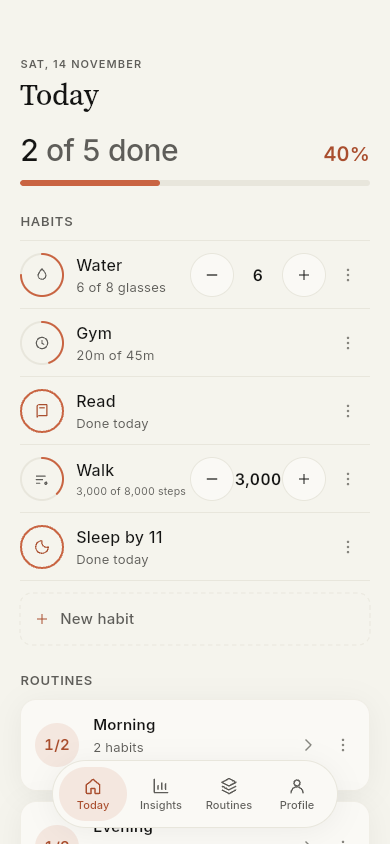
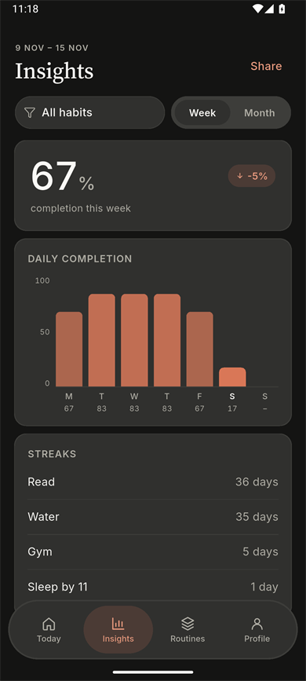

<p align="center">
  
</p>

<h1 align="center">Accrue</h1>

<p align="center"><em>A calm, local-first habit tracker for Android.</em></p>

<p align="center">
  <a href="https://github.com/asterxsk/accrue/releases/latest"></a>
  
  
</p>

---

Accrue is a quiet place to keep habits. Check things off, count them up, or run a timer — then
see the week settle into shape. There is no account, no sync and no server: every habit, routine
and streak lives in local storage on the device.

<p align="center">
  
  
  
</p>

## What it does

- **Three kinds of habit.** A check habit is done or not; a count habit takes whatever increment
  suits it — halves included; a timer habit runs a countdown that keeps the screen honest.
- **Routines.** Order habits into a sequence and work through it one step at a time.
- **Swipe between tabs.** Today, Insights, Routines and Profile move under your thumb.
- **Icons or badges.** Every habit carries either a Lucide icon chosen by search from the full
  1,865-icon set, or a one- or two-character text badge on a gradient of your choosing.
- **Week and month insights.** A seven-bar week with per-day shares, a month heat map that darkens
  with the share of habits completed, streaks, and a filter for one habit at a time.
- **Per-habit reminders.** Every habit can carry its own daily notification, set on a scrolling
  hour-and-minute clock. The profile switches between 12- and 24-hour time; 12-hour adds AM/PM.
- **Import and export.** A whole-device JSON backup, restorable from the Data & export page.
- **Manual updates.** The corner button on Profile checks the GitHub releases API when tapped —
  never in the background — and a newer build downloads with progress and installs through
  Android's own installer. The download is checked against the release's SHA-256 before it is
  offered.
- **Focus blocking (Android).** While a timer habit runs, an accessibility overlay covers apps you
  have flagged as distracting, with a countdown and a way back into Accrue. Each timer habit can
  opt out.
- **Share poster.** A 4:5 card of the week — the bars, the totals and a projection of where the
  current pace leads. Share sends its numbers as text.
- **A small celebration.** Finishing a habit fires confetti cannons from both top corners with a
  cannon pop, whichever way it was completed. The scrolling time wheels tick as they pass each value.

## Install

Download the latest APK from [Releases](https://github.com/asterxsk/accrue/releases/latest) and
open it on an Android 7.0 or newer device. Releases are signed with a stable release key, so a
newer version installs straight over the installed one.

## Build from source

```sh
flutter pub get
flutter run        # with a device or emulator attached
```

Requires Flutter 3.47.9 (Dart 3.13). `flutter analyze` and `flutter test` should both be clean.

## Release

`.github/workflows/release.yml` builds the release APK and attaches it to a GitHub release.
Dispatch it once `pubspec.yaml` carries the version to ship:

```sh
gh workflow run release.yml
```

Pushing a tag (`git tag v2.2.0 && git push origin v2.2.0`) does the same. The workflow reads
`version:` from `pubspec.yaml`, runs analyze and tests, builds `flutter build apk --release`,
verifies the signature and publishes `accrue-<version>.apk`.

Release builds are signed with the project's release keystore so versions install over each other.
The keystore and its passwords live in repository secrets (`KEYSTORE_BASE64`, `KEYSTORE_PASSWORD`,
`KEY_ALIAS`, `KEY_PASSWORD`). A local release build only picks up that key when an untracked
`android/key.properties` points at it; without that file Gradle falls back to the debug key, which
the workflow's certificate check rejects. **Back the keystore up** — without it, no future release
can update an installed copy.

The signing key was rotated on 2026-11-18 after the previous one was exposed. v2.5.0 is the first
build on the new key, so it cannot install over v2.2.1–v2.4.2: export, uninstall, then install.

## Project layout

| Path | What lives there |
| --- | --- |
| `lib/theme` | Colour tokens, type scale, metrics, light and dark themes |
| `lib/models` | Habits, routines, starter sets, habit-idea catalogue |
| `lib/state/habit_store.dart` | State, day rollover, streaks, weeks, month heat data, timer, import/export, persistence |
| `lib/screens` | Onboarding and the four tabs, plus pushed detail, profile, editor and data screens |
| `lib/widgets` | Shared control set, generated Lucide library, dialogs, wheel picker, heat map, share poster, brand mark |
| `lib/util/focus.dart` + `android/.../FocusAccessibilityService.kt` | Focus-blocking channel, app list, overlay |
| `lib/util/reminders.dart` | Per-habit daily notification scheduling |
| `lib/util/updates.dart` | GitHub release lookup, verified APK download, install hand-off |
| `tool/gen_icons.py` | Regenerates `lib/widgets/icon_library.dart` from a local `lucide-static` tree |
| `tool/demo_main.dart` | Dark demo entrypoint used for the README captures |
| `tool/export_brand.py` | Exports the in-app enso mark to `docs/brand/accrue-enso.svg` |
| `docs/` | [Product brief](docs/PRD.md) and the brand mark |
| `screenshots/` | Dark captures of the built Android app at 390×867, plus the Android focus overlay at 1080×2400 |

Deliberate divergences from the prototype are recorded in [NOTES.md](NOTES.md).

## Brand

The mark is an enso: one unclosed brush ring in clay on a transparent ground, drawn from the same
1024pt geometry as the launcher icon and the About screen.

| Token | Light | Dark |
| --- | --- | --- |
| Accent (clay) | `#C96442` | `#D97757` |
| Ground | `#F5F4ED` | `#141413` |
| Ink | `#141413` | `#F5F4ED` |

Type is a serif display face over a neutral sans, with wide-tracked uppercase eyebrows.

## Credits

Built and signed by **Wrong Turn**. Typefaces ship under the SIL Open Font License; icons come from
[Lucide](https://lucide.dev). Built with Flutter.
